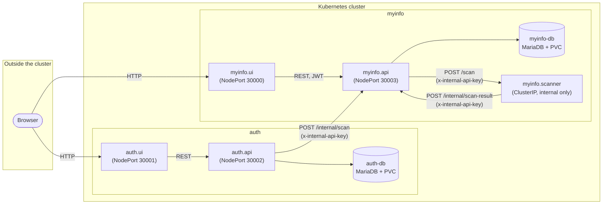
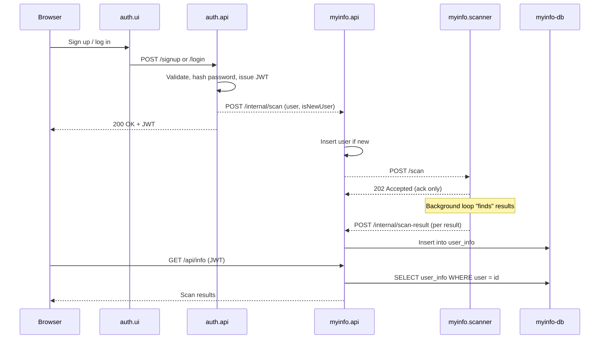

# Myinfo

Myinfo is a demo app that allows users to find their digital footprint on the internet by scanning multiple sources and data brokers on the internet. Once a user signs up, a scanner service is launched which performs the actual scanning. The data is presented through a UI to the user. 

## Setup

### Configuration

The app is configured via two files in `k8s/`, neither of which is committed to git:

1. Copy `k8s/config.yml.example` to `k8s/config.yml` — non-sensitive settings (service URLs,
   DB names/users).
1. Copy `k8s/secrets.yml.example` to `k8s/secrets.yml` — sensitive values (`AUTH_DB_PASS`,
   `MYINFO_DB_PASS`, `JWT_SECRET`), kept out of the `ConfigMap` and applied as a Kubernetes
   `Secret` instead.
1. Fill in real values in both files (at minimum, change the placeholder passwords/secrets).

For local development with `docker-compose` instead of Kubernetes, copy `.env.example` to `.env`
and fill it in the same way — `docker-compose.yml` loads it via `env_file`.

### Running

Run `kubectl apply -f k8s` or `yarn start` to start the app.

## Architecture

The app is split into two independently deployable "products" — **auth** (sign up / log in) and **myinfo** (the footprint scan) — each with its own UI, API, and database. A `myinfo.scanner` service performs the actual (simulated) scanning work. Every service is stateless and horizontally scalable except the two databases.

- **auth.ui / myinfo.ui** — React SPAs served by a small Express host, the only components reachable from a browser (`NodePort`).
- **auth.api** — owns signup/login, issues JWTs, and is the only service with write access to `auth-db`.
- **myinfo.api** — owns the scanned data, validates the JWT on `/api/*`, and exposes `/internal/*` routes used only by other services.
- **myinfo.scanner** — stateless worker that performs the (fake) data-broker scan; has no database of its own and is only reachable from inside the cluster (`ClusterIP`).
- **auth-db / myinfo-db** — one MariaDB instance per bounded context, each backed by a `PersistentVolumeClaim` so data survives pod restarts. Not scaled (`replicas: 1`), per the assignment's requirements.

### Signup → scan flow

Scanning is kicked off as a side effect of signup/login and runs asynchronously: `myinfo.scanner` acknowledges the scan request immediately (`202`) and reports results back once it "finds" them.

All service-to-service calls under `/internal/*` require a shared `INTERNAL_API_KEY` sent via the `x-internal-api-key` header, since `myinfo-api`'s Service is exposed as `NodePort` and would otherwise be reachable from outside the cluster.