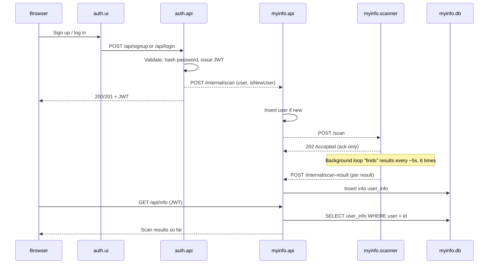

# Myinfo — Project Report

## 1. Software Description

**Myinfo** is a demo application for exploring a user's digital footprint. After a user
creates an account or logs in, a scanner searches simulated data brokers and websites for
information associated with that user and sends each result to the application. The concept is
inspired by digital-footprint and data-removal services, but the scan data is generated for this
assignment rather than collected from real websites.

---

## 2. Software Architecture Design

### 2.1 Overview

The application has two independently deployable parts: **auth**, which handles account
registration and login, and **myinfo**, which stores and displays scan results. Each has its own
UI, API, and database. The `myinfo.scanner` service performs the simulated scan. The application
services are stateless and can be scaled independently; the databases use persistent storage and
run as single replicas, which meets the assignment's database requirement.

### 2.2 Component responsibilities and their mapping to microservices

| Component | Microservice | Responsibility |
|---|---|---|
| Auth UI | `auth.ui` | React SPA served by a small Express host. Sign-up/login forms. Only browser-facing component for the auth product. |
| Auth API | `auth.api` | Owns signup/login flow. Validates input, hashes passwords (`bcryptjs`), issues JWTs (`jsonwebtoken`). Sole writer to `auth.db`. Triggers a scan request as a side effect of signup/login. |
| Auth DB | `auth.db` | MariaDB instance holding auth-related data. Backed by a PVC. |
| Myinfo UI | `myinfo.ui` | React SPA. Shows scan results for the logged-in user. Only browser-facing component for the myinfo product. |
| Myinfo API | `myinfo.api` | Owns scanned data. Exposes `GET /api/info` (JWT-protected, reads `user_info` for the caller) and `POST /internal/*` routes used only by other services (requesting/reporting scans). Sole writer to `myinfo.db`. |
| Myinfo DB | `myinfo.db` | MariaDB instance holding `users` and `user_info`. Backed by a PVC. |
| Scanner | `myinfo.scanner` | Stateless worker. Accepts a scan request, acknowledges immediately (`202`), then asynchronously "finds" and reports results. Has no database of its own and is not reachable from outside the cluster. |

### 2.3 Interaction between microservices

The application services communicate over REST (JSON over HTTP). Internal requests use
Kubernetes Service DNS names such as `myinfo-api` and `myinfo-scanner`. The `auth.api` and
`myinfo.api` services each access their own database; neither service queries the other's
database directly. This database-per-service design supports independent deployment and scaling.

The signup → scan flow, which is the core interaction in the system:

Key points this demonstrates:

- **Non-blocking handoff.** `auth.api` starts a request to `myinfo.api` without waiting for its
  result. Likewise, `myinfo.api` starts a request to the scanner and returns `202 Accepted`.
  Signup and login responses therefore do not wait for the scan to finish. Request failures are
  logged, but are not retried.
- **Immediate acknowledgement, asynchronous work.** The scanner's `POST /scan` endpoint responds
  with `202 Accepted` before generating results in the background. This avoids keeping an HTTP
  connection open while the simulated scan runs.
- **Polling, not push.** The UI retrieves results through `GET /api/info`; the application does
  not use WebSockets or server-sent events. A user may see only some results until they reload
  the page.

### 2.4 Architecture / cloud patterns used

This section names the specific patterns applied, based on Wilder's *Cloud Architecture
Patterns* [1] and Ibryam & Huss's *Kubernetes Patterns* [2].

- **Horizontally Scaling Compute Pattern** [1]. The application services are stateless and can
  be scaled independently by running additional replicas.
- **Declarative Deployment** [2]. Kubernetes Deployments, Services, configuration, secrets, and
  persistent volume claims are defined in the `k8s/` manifests and applied with `kubectl apply`.
- **Service Discovery** [2]. The scanner uses a `ClusterIP` Service, while the APIs and UIs use
  `NodePort` Services for browser access. Internal requests use Kubernetes Service DNS names.
  Because `myinfo.api` also uses `NodePort`, its internal routes are reachable through that
  external service as well.
- **Stateful Service** [2] — Both databases mount a `PersistentVolumeClaim` so data survives pod restarts/rescheduling.

---

## 3. Benefits, Challenges, and Security Discussion

### 3.1 Benefits

- **Independent scaling and deployment.** Because `auth` and `myinfo` are separate products
  with separate databases, either can be scaled, redeployed, or even rewritten without touching
  the other. Within `myinfo`, the scanner can scale independently from the API that serves
  results, which matters if scanning work is heavier than serving reads.
- **Clear ownership boundaries.** Each database has exactly one writer. This avoids the
  classic shared-database coupling problem where any service can corrupt another's data model.
- **Resilience to slow work.** The async, acknowledge-then-work pattern (`202` + background
  loop) means a slow or flaky scan never blocks signup/login, and a user-facing request never
  times out waiting on simulated "scanning."
- **Small, understandable blast radius per service.** Each service does one thing (auth,
  serving scan data, performing a scan) and is small enough to reason about and redeploy on its
  own.

### 3.2 Challenges and how they're addressed (or not yet)

- **Dependency on downstream services.** The flow `auth.api → myinfo.api → myinfo.scanner` uses
  direct REST calls, so each service must be reachable for the next step to succeed. Callers log
  failures and continue, which keeps user requests from waiting on the scan pipeline, but there
  is no retry, backoff, or queue to recover failed scan requests. This can be addressed by utilising the *queue-centric workflow pattern*, but that is outside the scope of the project requirement.

- **Security — authentication and data in transit.** Credentials are never stored or passed
  around in plain text, and a user's identity is verified on every request rather than trusted
  once at login. This addresses the risk of session hijacking or credential theft.
- **Security — internal service boundary.** Because one of the internal services must also be
  reachable from the browser for its public routes, its internal-only routes are incidentally
  exposed on the same network path rather than being fully isolated. This is mitigated with a
  shared-secret check between services, which is a reasonable control at this scale but weaker
  than giving each service its own verifiable identity (e.g. mutual TLS or a service mesh),
  which would be the production-grade fix.
- **Security — secrets management.** Credentials are kept out of source control and out of the
  general application configuration, isolated in a dedicated secrets mechanism. The residual
  gap is that this mechanism only obscures values rather than encrypting them at rest, so
  anyone with cluster access could still read them directly — a production deployment would
  need encryption at rest or an external secrets manager to close that gap.

- **No Elastic Scale** [2]. Scaling is manual with `kubectl scale`. A
  `HorizontalPodAutoscaler` based on CPU or memory could automate replica changes under load.

**Business implication of these design choices.** The database-per-service split means a
future change, such as replacing `myinfo`'s database or connecting the scanner to real
third-party APIs, can be focused on the myinfo services while leaving account management in
auth largely unchanged. This can reduce the effort required to change scan behavior. The tradeoff
is greater operational overhead than a monolith: the system has two databases, five deployable
application services, and internal API credentials to manage. For this small demonstration,
microservices add complexity, but they make the assignment's independent deployment and scaling
requirements visible.

---

## References

Source code repository (application and Kubernetes deployment code):
<https://github.com/dkyeremeh/myinfo>

In this repository:

- Full setup/run instructions: `../README.md`
- Kubernetes manifests: `../k8s/`
- Video walkthrough outline: `../VIDEO_SCRIPT.md`

Works cited:

1. B. Wilder, *Cloud Architecture Patterns*, O'Reilly, 2012. ISBN: 978-1-449-31977-9.
2. B. Ibryam and R. Huss, *Kubernetes Patterns: Reusable Elements for Designing Cloud-Native
   Applications*, O'Reilly, 2019. ISBN: 978-1-492-05028-5.
