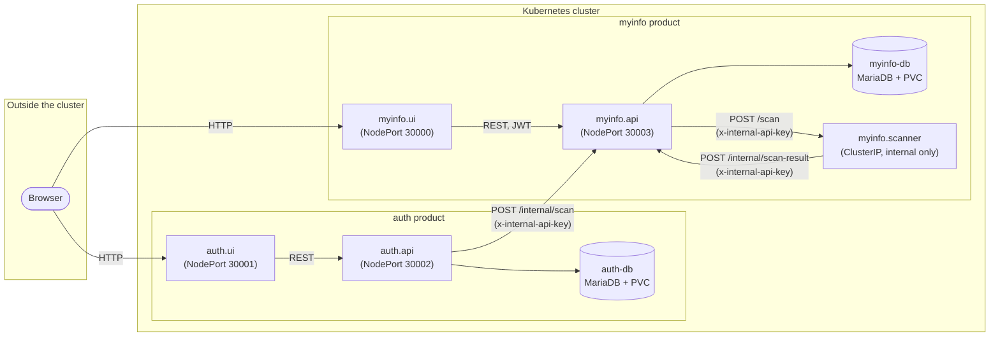

# Myinfo — Project Report

Written for the microservices assignment deliverables: software description, architecture
design, and a discussion of benefits/challenges (including security). The configuration
management repository and the demo video are submitted alongside this document (see
`../README.md` for repo navigation and `../VIDEO_SCRIPT.md` for the recording outline).

---

## 1. Software Description

**Myinfo** is a demo application that lets users find their "digital footprint" on the
internet. A user signs up, and in the background a scanner service searches (simulated) data
brokers and web sites for information tied to that user, reporting results back as they're found.
The idea is loosely based on real digital-footprint / data-removal services (e.g. people-search
opt-out tools), scaled down to something buildable and demoable for this assignment.

---

## 2. Software Architecture Design

### 2.1 Overview

The application is split into two independently deployable **products** — **auth** (identity:
sign up / log in) and **myinfo** (the footprint scan) — each with its own UI, API, and
database. A third, shared worker (`myinfo.scanner`) performs the actual scan. Every service is
stateless and horizontally scalable except the two databases, which the assignment explicitly
does not require to scale.

### 2.2 Component responsibilities and their mapping to microservices

| Component | Microservice | Responsibility |
|---|---|---|
| Auth UI | `auth.ui` | React SPA served by a small Express host. Sign-up/login forms. Only browser-facing component for the auth product. |
| Auth API | `auth.api` | Owns signup/login. Validates input (`yup`), hashes passwords (`bcryptjs`), issues JWTs (`jsonwebtoken`). Sole writer to `auth-db`. Triggers a scan request as a side effect of signup/login. |
| Auth DB | `auth-db` | MariaDB instance holding `auth_users`. Backed by a PVC. |
| Myinfo UI | `myinfo.ui` | React SPA. Shows scan results for the logged-in user. Only browser-facing component for the myinfo product. |
| Myinfo API | `myinfo.api` | Owns scanned data. Exposes `GET /api/info` (JWT-protected, reads `user_info` for the caller) and `POST /internal/*` routes used only by other services (requesting/reporting scans). Sole writer to `myinfo-db`. |
| Myinfo DB | `myinfo-db` | MariaDB instance holding `users` and `user_info`. Backed by a PVC. |
| Scanner | `myinfo.scanner` | Stateless worker. Accepts a scan request, acknowledges immediately (`202`), then asynchronously "finds" and reports results. Has no database of its own and is not reachable from outside the cluster. |

### 2.3 Interaction between microservices

All five app services communicate over plain REST (JSON over HTTP), not an event bus — each
call is a synchronous HTTP request between two known services, resolved by Kubernetes Service
DNS names (`myinfo-api`, `myinfo-scanner`), not `localhost`.

The signup → scan flow, which is the core interaction in the system:

Key points this demonstrates:

- **Fire-and-forget, non-blocking handoff.** `auth.api` doesn't wait on `myinfo.api`, and
  `myinfo.api` doesn't wait on `myinfo.scanner` — each call is dispatched and the caller moves
  on, so a user's signup/login response is never delayed by the scan pipeline.
- **Immediate acknowledgement, async work.** `myinfo.scanner`'s `POST /scan` responds `202`
  right away, then keeps working in the background — a pattern that avoids a long-held HTTP
  connection for work that takes tens of seconds.
- **Polling, not push.** The UI only ever sees results it explicitly asks for via `GET
  /api/info` — there's no WebSocket/SSE channel, so a user who loads the results page
  immediately after signup may see a partial list until they refresh.

### 2.4 Architecture / cloud patterns used

- **Database-per-service.** `auth.api` and `myinfo.api` each own a private database; neither
  ever queries the other's DB directly. This keeps the two products independently deployable
  and independently scalable, and means a schema change in one never risks the other.
- **API Gateway-free, direct service-to-service REST.** There's no shared gateway/broker in
  front of internal calls — each service calls the specific downstream service it needs by
  Kubernetes Service name. Simpler than an event bus for this scale, at the cost of tighter
  coupling between the calling and called service's availability (see §3).
- **Stateless service replicas.** Every app service keeps no in-memory session/scan state that
  isn't written to a database — `myinfo.scanner`'s in-progress scans live in a `setInterval`
  closure inside one pod, which is a known limitation (see §3), but the API/UI tiers are fully
  stateless and safe to scale or restart freely.
- **Internal/external boundary via Service type.** `ClusterIP` (`myinfo-scanner`) vs `NodePort`
  (everything meant to be reachable from a browser, plus `auth-api`/`myinfo-api` which also need
  external reachability for their public `/api/*` routes) is used to express which services are
  meant to be called from outside the cluster — though see §3 for the gap this leaves on
  `myinfo.api`.
- **Config/secret separation.** Non-sensitive configuration (service URLs, DB names/users) lives
  in a Kubernetes `ConfigMap`; sensitive values (`AUTH_DB_PASS`, `MYINFO_DB_PASS`, `JWT_SECRET`)
  live in a `Secret`, injected via `envFrom`/`secretKeyRef` — scoped per-service to only the
  secrets each one actually needs, rather than handing every service every secret.
- **Persistent storage for stateful components only.** Both databases mount a
  `PersistentVolumeClaim` at `/var/lib/mysql`, so data survives pod restarts/rescheduling. No
  app-tier service needs persistent storage, since they're all stateless.

---

## 3. Benefits, Challenges, and Security Discussion

### 3.1 Benefits

- **Independent scaling and deployment.** Because `auth` and `myinfo` are separate products
  with separate databases, either can be scaled, redeployed, or even rewritten without touching
  the other. Within `myinfo`, the scanner can scale independently from the API that serves
  results, which matters if scanning work is heavier than serving reads.
- **Clear ownership boundaries.** Each database has exactly one writer. This avoids the
  classic shared-database coupling problem where any service can corrupt another's data model.
- **Resilience to slow work.** The async, acknowledge-then-work pattern (`202` + background
  loop) means a slow or flaky scan never blocks signup/login, and a user-facing request never
  times out waiting on simulated "scanning."
- **Small, understandable blast radius per service.** Each service does one thing (auth,
  serving scan data, performing a scan) and is small enough to reason about and redeploy on its
  own.

### 3.2 Challenges and how they're addressed (or not yet)

**Eventual consistency / partial results.** Because results arrive over ~30 seconds and the UI
only polls on demand, a user can see an empty or partial list right after signing up.
*Mitigation*: this is accepted as an inherent property of the async design and called out
explicitly in this report and the video — a production system would likely add a
loading/"still scanning" UI state or a push channel (WebSocket/SSE), which was out of scope here.

**Tight coupling via direct REST calls.** `auth.api` calling `myinfo.api` calling
`myinfo.scanner` means each caller needs the callee to be reachable *right now*. If
`myinfo.scanner` is down, `myinfo.api`'s call to it fails outright (logged, not retried
indefinitely). *Mitigation*: calls are fire-and-forget with `.catch` logging so a downstream
failure doesn't crash or block the caller; a more robust system would add retries with backoff
or fall back to a message queue for durability — noted as a possible improvement, not
implemented, given the assignment's scope.

**In-memory scan state is not fault-tolerant.** `myinfo.scanner`'s in-progress scan loop
(`setInterval`) lives entirely in one pod's memory. If that pod is killed or rescheduled
mid-scan, the remaining results for that scan are lost silently (no error, no retry — the
background loop just stops existing). *Mitigation*: none implemented; acceptable for a demo
given scans are short-lived and idempotent-ish (a user can just log in again to retrigger one),
but would need to move to a durable queue/job table to be production-safe.

**Security — authentication and authorization:**
- User passwords are hashed with `bcryptjs` (cost factor 10) before storage — never stored or
  logged in plaintext.
- Session/identity is a signed JWT (`jsonwebtoken`), verified by `myinfo.api`'s
  `authMiddleWare` on every `/api/*` request; `myinfo.api` and `auth.api` share the same
  `JWT_SECRET` (via the `Secret`, not the `ConfigMap`) so a token issued by one is verifiable by
  the other. Tokens expire after 1 hour.
- Input is validated with `yup` schemas before touching the database (e.g. signup requires a
  minimum-length name, matching `password`/`repassword`), reducing malformed/malicious input
  reaching the DB layer.

**Security — the internal API surface.** `myinfo.api`'s Kubernetes `Service` is `NodePort`
(it needs to be, since its `/api/*` routes are meant to be called from the browser) — but that
also means its `/internal/scan` and `/internal/scan-result` routes, which are meant *only* for
other services, are technically reachable from outside the cluster too. *Mitigation*: both
those routes, and `myinfo.scanner`'s `/scan` route, are gated behind a shared
`INTERNAL_API_KEY`, checked via an `x-internal-api-key` header (`requireInternalKey`
middleware), rejecting any request that doesn't present it. This is a single static shared
secret rather than per-service identity (e.g. mTLS or a service mesh), which is a reasonable
trade-off for this scale but would not hold up at larger scale — a real system would use
per-service credentials or a mesh with mutual TLS instead of one shared key.

**Security — secrets at rest.** `AUTH_DB_PASS`, `MYINFO_DB_PASS`, and `JWT_SECRET` are kept out
of the `ConfigMap` and the git repo entirely, injected via a Kubernetes `Secret` instead (itself
gitignored in its concrete `k8s/secrets.yml` form — only a placeholder `.example` file is
committed). *Known gap*: Kubernetes `Secret`s are only base64-encoded, not encrypted, at rest by
default — anyone with cluster access can read them via `kubectl get secret -o yaml`. A
production deployment would want encryption-at-rest enabled on the cluster (e.g. via a KMS
provider) or an external secrets manager; not configured here since the assignment runs on a
local cluster.

**Business implication of these design choices.** The database-per-service split means a
future pivot (e.g. swapping `myinfo`'s storage for a different database technology, or
rewriting the scanner to call real third-party APIs) touches only that product, not `auth` —
reducing the cost of iterating on the "scan" business logic, which is the part most likely to
change, while the identity/auth product stays stable. The trade-off is operational overhead:
two databases, five deployable units, and inter-service auth to maintain, which is more
infrastructure than a monolith would need — a reasonable cost for a system expected to grow
unevenly across its two products, and an explicit demonstration of the assignment's
microservices requirements rather than a claim that this is the simplest way to build this
specific small application.

---

## References

- Full setup/run instructions: `../README.md`
- Kubernetes manifests: `../k8s/`
- Video walkthrough outline: `../VIDEO_SCRIPT.md`
